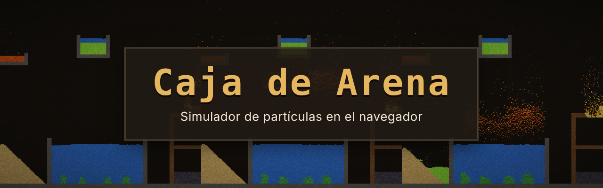
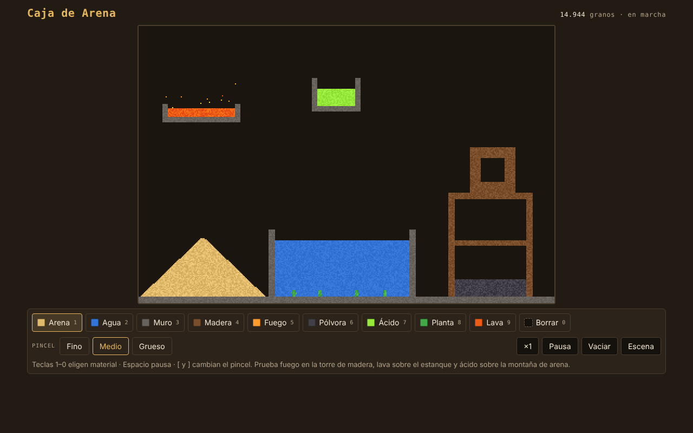
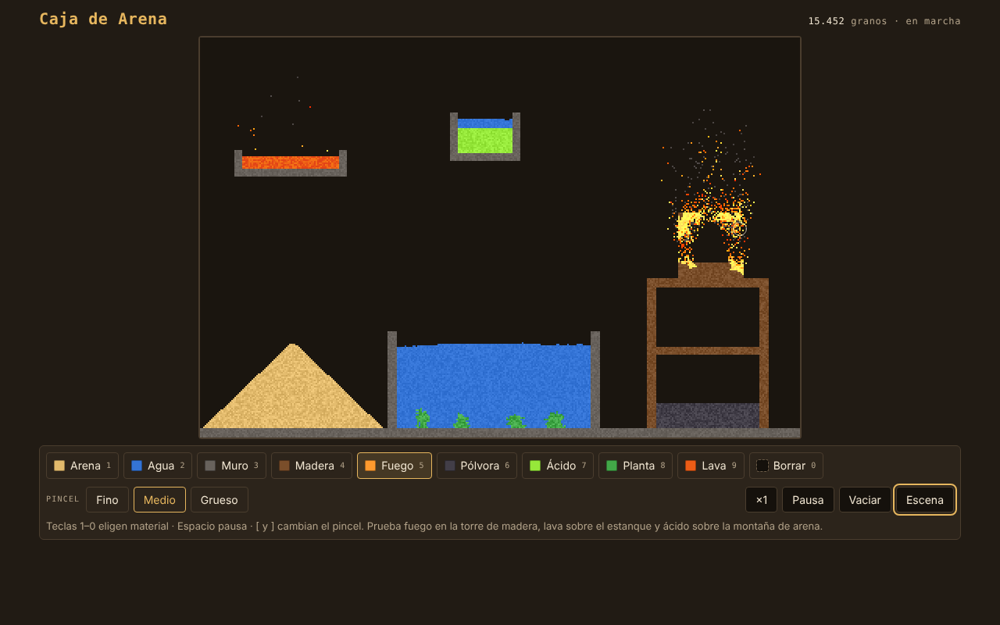
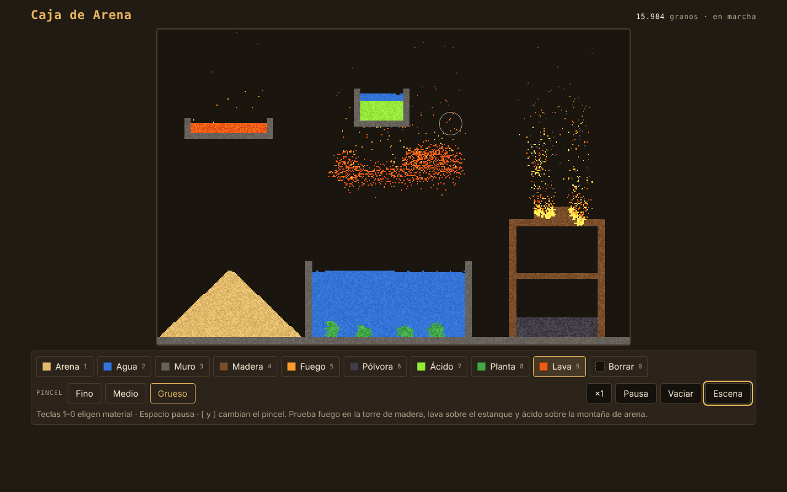
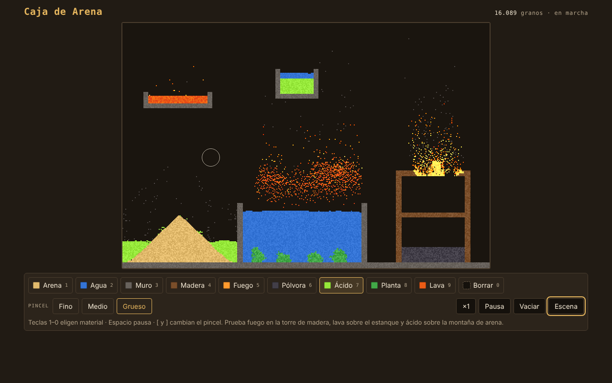
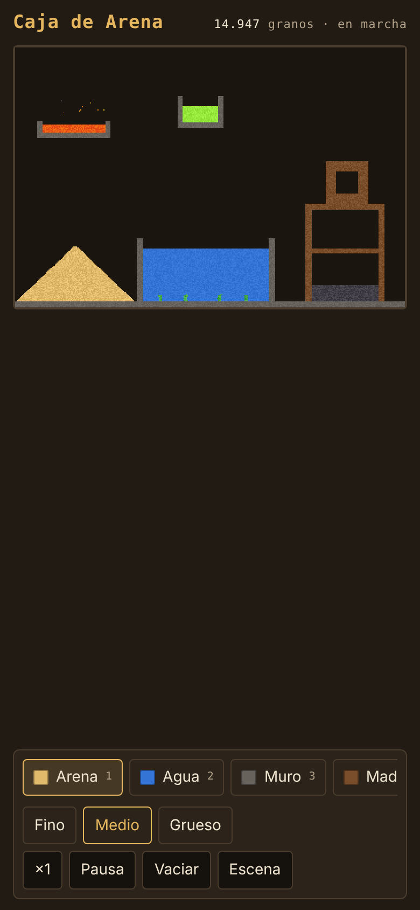
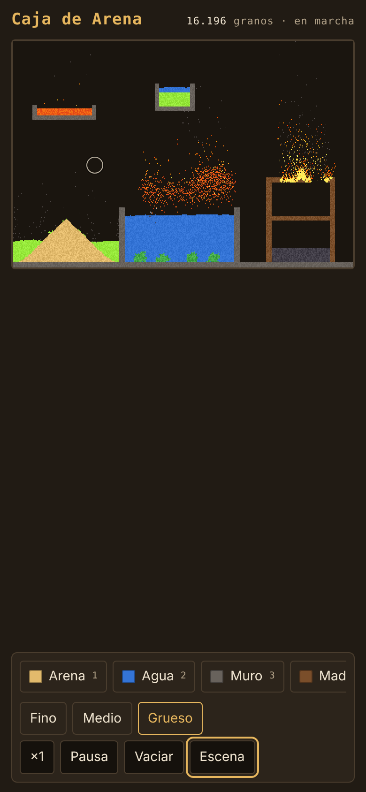
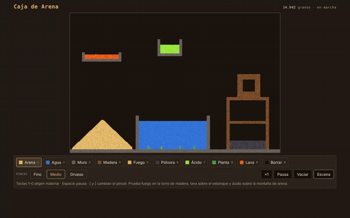
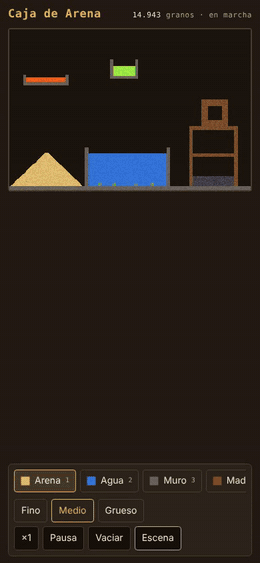

<div align="center">



# ⏳ Caja de Arena

**Un simulador de partículas en el navegador.**
Dibuja arena, agua, fuego, pólvora, ácido, plantas y lava y mira cómo reaccionan entre sí. Cada grano sigue reglas locales y todo lo demás sale solo.

[](https://ivanchux.github.io/caja-de-arena/)


</div>

---

## 📑 Índice

[Qué es](#-qué-es) · [Capturas](#-capturas) · [En movimiento](#-en-movimiento) · [Cómo se usa](#-cómo-se-usa) · [Materiales y reacciones](#-materiales-y-reacciones) · [Ejecutar y publicar](#-ejecutar-y-publicar) · [Detalles técnicos](#-detalles-técnicos) · [Estructura](#-estructura-del-repositorio) · [Licencia](#-licencia)

## ⏳ Qué es

Caja de Arena es una cuadrícula de **384 × 256 celdas** en la que cada celda contiene un material. En cada paso, cada material mira a sus vecinos y decide qué hace: la arena cae, el agua se reparte, el fuego prende la madera y la lava convierte el agua en piedra.

- **Un solo archivo** (`index.html`), sin librerías, sin instalación y sin servidor.
- Funciona con **ratón, teclado y pantalla táctil**.
- **Sin peticiones de red** y sin guardado de datos: lo que dibujas desaparece al cerrar la pestaña.
- Al abrirlo ya hay una **escena preparada**: una montaña de arena, un estanque con plantas, una repisa de lava, un vaso de ácido y una torre de madera con pólvora dentro.

## 📸 Capturas

<div align="center">

| Escena inicial | Fuego en la torre |
|:---:|:---:|
|  |  |

| Lava sobre el estanque | Ácido sobre la arena |
|:---:|:---:|
|  |  |

 &nbsp; 

*En el móvil se dibuja con el dedo y la barra de materiales se desplaza hacia los lados.*

</div>

## 🎬 En movimiento

<div align="center">

**En el PC:** agua desde arriba, fuego en la torre de madera, lava sobre el estanque y ácido sobre la montaña de arena



**En el móvil**



</div>

## 🕹️ Cómo se usa

Elige un material y dibuja sobre la caja. No hay puntos, niveles ni fin de partida.

| Acción | PC | Móvil |
|---|---|---|
| Dibujar | Mantén pulsado el ratón y arrastra | Arrastra el dedo |
| Elegir material | Botones o teclas `1` a `0` | Botones |
| Cambiar el pincel | Fino, Medio y Grueso, o teclas `[` y `]` | Botones |
| Pausar y reanudar | Botón **Pausa** o `Espacio` | Botón **Pausa** |
| Velocidad | Botón `×1`: alterna entre ×1, ×2 y ×0,5 | Igual |
| Vaciar la caja | Botón **Vaciar** | Igual |
| Volver a la escena inicial | Botón **Escena** | Igual |

## 🧪 Materiales y reacciones

| Material | Tecla | Qué hace |
|---|:-:|---|
| **Arena** | `1` | Cae y forma montones. |
| **Agua** | `2` | Cae y se reparte por los lados. Apaga el fuego y lo convierte en vapor. |
| **Muro** | `3` | Fijo. El ácido y las explosiones no lo rompen. |
| **Madera** | `4` | Fija. Arde mucho más tiempo que una llama suelta. |
| **Fuego** | `5` | Prende la madera y las plantas, sube y se apaga solo. Si toca pólvora, la hace explotar. |
| **Pólvora** | `6` | Cae como la arena. Explota al contacto con fuego o lava y prende lo inflamable que tiene alrededor. |
| **Ácido** | `7` | Disuelve casi todo lo que toca y se va gastando. No afecta a muros, agua, humo, vapor ni fuego. |
| **Planta** | `8` | Fija e inflamable. Crece convirtiendo en planta el agua que tiene al lado. |
| **Lava** | `9` | Prende lo inflamable y detona la pólvora. Al tocar el agua se vuelve piedra y suelta vapor. |
| **Borrar** | `0` | Vacía las celdas que pinta. |

Además hay tres materiales que aparecen solos: el **humo** (sale de los fuegos y se disipa), el **vapor** (sube y a veces vuelve a ser agua) y la **piedra** (cae como la arena y una explosión puede romperla).

**Prueba esto:** fuego en la torre de madera, lava sobre el estanque y ácido sobre la montaña de arena.

## 🚀 Ejecutar y publicar

### Jugar en local

No hace falta instalar nada. Abre `index.html` en el navegador.

```bash
git clone https://github.com/Ivanchux/caja-de-arena.git
cd caja-de-arena
# abre index.html, o sirve la carpeta si prefieres:
python3 -m http.server 8000   # http://localhost:8000
```

### Publicar en GitHub Pages

1. Sube el repositorio a GitHub.
2. Ve a **Settings → Pages**.
3. En *Build and deployment* elige **Deploy from a branch**, rama `main` y carpeta `/ (root)`.
4. En un minuto estará en `https://ivanchux.github.io/caja-de-arena/`.

## 🔧 Detalles técnicos

- **Canvas 2D** de 384 × 256 píxeles, dibujado con un buffer de píxeles y escalado sin suavizar.
- **Simulación celular:** cada celda guarda su tipo, su vida y un tono. Las celdas se recorren de abajo arriba y alternan el sentido de izquierda a derecha en cada paso para que no haya sesgo.
- **Paso fijo de 1/60 s**, sea cual sea la frecuencia de la pantalla, con la velocidad ×0,5, ×1 o ×2.
- **Escala entera** del lienzo cuando cabe, para que todos los píxeles midan lo mismo.
- **Entrada unificada** con *pointer events*, válida para ratón, táctil y lápiz. Entre dos puntos del gesto se interpolan trazos para que no queden huecos.
- **Móvil:** `viewport-fit=cover`, márgenes de seguridad y `touch-action: none` en el lienzo.
- **Cero dependencias**, sin peticiones de red y sin almacenamiento.

## 📁 Estructura del repositorio

```text
caja-de-arena/
├── index.html        # El juguete completo (HTML + CSS + JS)
├── docs/             # Banner, capturas y GIFs de este README
├── icon-512.png      # Iconos de la página
├── CHANGELOG.md      # Historial de versiones
├── LICENSE           # PolyForm Noncommercial 1.0.0
└── README.md
```

## 🗺️ Ideas futuras

- [ ] Guardar y compartir una escena
- [ ] Más materiales (hielo, aceite, metal)
- [ ] Pausa automática al cambiar de pestaña
- [ ] Mejor aprovechamiento de la pantalla en el móvil en vertical

## 📜 Licencia

El código está bajo **[PolyForm Noncommercial 1.0.0](LICENSE)**.

**Puedes, sin pedir permiso:**
- Jugarlo y compartir el enlace.
- Estudiar el código y modificarlo para uso personal, educativo o sin ánimo de lucro.
- Subirlo a otra web o a tu propio hosting, siempre gratis y sin anuncios, conservando el aviso de copyright y la licencia.
- Hacer streams, vídeos y capturas, aunque tu canal esté monetizado.

**Necesitas mi permiso por escrito para:**
- Vender el juego, una copia o una versión modificada.
- Publicarlo en tiendas de aplicaciones o plataformas de juegos.
- Incluirlo en una web con anuncios, suscripciones o compras.

---

<div align="center">

Hecho con ⏳ por **[Ivanchux](https://github.com/Ivanchux)**

⭐ Si te ha gustado, deja una estrella al repositorio.

</div>
